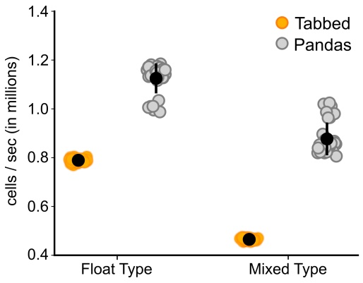
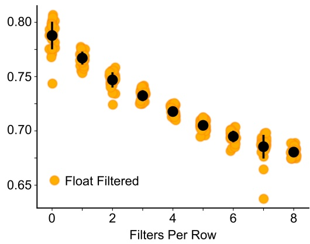

# Tabbed: A Python package for reading variably structured text files at scale

**Matthew S. Caudill** 1,2

**DOI:** [10.21105/joss.08964](https://doi.org/10.21105/joss.08964)

## Software

• [Review](https://github.com/openjournals/joss-reviews/issues/8964)

• [Repository](https://github.com/mscaudill/tabbed)

• [Archive](https://doi.org/10.5281/zenodo.17554453)

**Editor:** [Neea Rusch](https://nkrusch.github.io)

## Reviewers:

• [@jolars](https://github.com/jolars)

• [@ymahlau](https://github.com/ymahlau)

• [@navekshasood](https://github.com/navekshasood)

**Submitted:** 09 July 2025

**Published:** 11 November 2025

## License

Authors of papers retain copyright and release the work under a Creative Commons Attribution 4.0 International License ([CC BY 4.0](https://creativecommons.org/licenses/by/4.0/)).

1 Department of Neuroscience, Baylor College of Medicine, Houston, TX, United States of America 2 Jan and Dan Duncan Neurological Research Institute at Texas Children’s Hospital, Houston, TX, United States of America

## Summary

Delimiter separated value (DSV) text files are ubiquitous for representing tabular data. For example, a search of GitHub for comma separated value files, a subset of the DSV format, returns 75 million matches. They are simple to create, easy to share, and can encode a variety of data types. Despite their broad use, variability in the formatting and structure of DSV files has hindered attempts to automate their parsing for decades. The clevercsv package (Burg et al., 2019) made significant progress on this problem with consistency measures that accurately detect a file’s dialect: delimiter, quote character, and escape character. The structure of a DSV file introduces another source of variability. DSVs may contain a metadata section that offsets the header and start row. Tabbed uses row length and type consistency measures to automatically detect metadata, header and data sections of a DSV file. Furthermore, tabbed provides a value-based conditional reader for reading these irregular DSV files at scale.

## Statement of need

To the best of our knowledge, no parser of DSV files exists that can locate the start of the data section irrespective of the presence of metadata and/or a header. Further, we found no reader of DSV files that can conditionally read rows from the data section based on a row’s type casted values. We here define a set of desiderata for parsing irregular text files that optionally contain metadata, header, and ragged data rows. To motivate this set, we consider the DSV shown in Figure 1.

```txt
Experiment ID; Experiment
Animal ID; Animal
Researcher; Test
path = '/home/user/experiments/states.txt'
Number | Start Time | Runtime | Annotation
02/09/22 09:17:38.948 0.0000 | Started Recording
02/09/22 09:37:00.000 1161.0520 start
02/09/22 09:37:00.000 1161.0520 exploring
02/09/22 09:37:08.784 1169.8360 grooming
12 02/09/22 09:37:13.897 1174.9490 exploring
```

Figure 1: The first 12 lines of a delimiter separated file named sample.txt with metadata on lines 1-4 and a header on line 7. The metadata contains both semicolon-delimited and undelimited strings. Notice the data section uses a different delimiter than the metadata and contains mixed data types.

## Structural Detection

A header line (line 7 of Figure 1) marks the boundary between the metadata and data sections of a file. Detection of this line is critical for correct automated parsing. Tabbed can locate a header line using string inconsistencies or type inconsistencies depending on the data types represented in the file. Importantly, some irregular DSV files do not have a header. In this case tabbed generates a header based on the number of data columns it measures from a sample of the file.

## Type Casting

Strings in the data section of the file shown in Figure 1 represent mixed types that need to be type casted. Tabbed supports conversion to int, float, complex, time, date and datetime instances. These conversions are graceful, returning strings on failure and logging the conversion problem for post-reading introspection.

## Value-based Filtering

Selectively reading rows from a DSV file based on type casted content is extremely useful for selecting subsets of the data. For example, in the sample file of Figure 1, users may want to only read data rows where the column named Annotation has a string value of exploring. Tabbed supports both column selection and row filtering with equality, membership, rich comparison, regular expression matching, and custom callables. To support an intuitive interface for creating these filters, tabbed uses simple keyword arguments passed to a method called tab of the Reader class. Below we illustrate the simplicity of constructing these filters for the sample file shown in Figure 1.

**from** tabbed.reading **import** Reader

```python
with open('sample.txt', 'r') as infile:
reader = Reader(infile)
# Tell the reader to only read these tabbed rows
reader.tab(Start_Time ='>=2/09/2022 9:37:00', Annotation = 'exploring')
result = reader.read()
```

## Iterative Reading

DSV files have no file size limits making it essential that readers support file streaming. Tabbed’s reader returns an iterator whose per-iteration memory consumption is tunable. For speed, this feature is implemented using a first-in-first-out (FIFO) data structure with O(1) time complexity allowing tabbed to linearly scale to large files.

## Comparison

Tablib (Reitz, 2016), comma (Lumbroso, 2020), pandas (McKinney, 2010; The pandas development team, 2025) and frictionless-py (Karev et al., 2025) are popular alternative packages to tabbed. Table 1 compares their respective features. Pandas read\_csv and Frictionless’ extract functions most closely match the available features in tabbed. Both support broad type casting and iterative reading of large files. However, both require specifying the header row if metadata is written to the file. This per file specification of the header location makes batch reading of text files with varying structure difficult. Additionally, neither package stores the skipped metadata section for later use.

Table 1: Comparison of features for four common open-source software packages for reading DSV files. Plus (+) and minus (-) indicates package support or lack of support for each feature respectively.

| Software | Structural Detection | Casting | Value-based Filtering | Iterative |
| --- | --- | --- | --- | --- |
| tablib | - | + | Row Equality Only | - |
| comma | - | limited | - | - |
| pandas | - | + | Columns Only | + |
| frictionless | - | + | + | + |
| tabbed | + | + | + | + |

Given that pandas read\_csv closely matches tabbed’s capabilities, we tested tabbed’s read speeds against pandas in Figure 2. For this test, we selected the python engine in pandas rather than the c or pyarrow engines which are an order of magnitude faster but do not support dialect inference like pandas python engine or tabbed’s Reader class. The speed test was conducted on a DSV file with all floats and a DSV file with floats and datetime instances. The file size in each case was 10 columns by 100,000 rows. The left panel of Figure 2 shows that tabbed is slower on both the float and mixed type files. Nevertheless, users can expect to read millions of cells from a DSV file in just a few seconds with tabbed.





Figure 2: Tabbed and pandas read speed comparison. Left: Comparison of number of cells casted per second between tabbed and pandas for DSV files composed of floats or mixed types. The conversion engine for pandas was chosen to be “python”. Right: Tabbed’s read speed as a function of the number of filters applied to each row during reading. In both panels black circles and error bars are the mean and standard deviation across 30 trials. These comparisons were carried out on a single 2.4 GHz Intel Core i5-6300U processor.

To further understand tabbed’s performance, we tested how row filtering impacts read speeds. The right panel of Figure 2 shows the read speed as a function of the number of filters applied to each data row. The left-most point is the baseline with no filters. We measure an approximate 2% reduction in speed for each new filter added.

## Conclusion

Automated reading of large irregularly structured DSV files, a format that is broadly used, is an open challenge. Tabbed’s four features—structural detection, type casting, value-based filtering, and iterative row reading—work together to automate reading of these files. The simple interface and deeply tested API of these features (see [documentation](https://mscaudill.github.io/tabbed/)) makes tabbed accessible to a broad audience of analysts, researchers, and developers across disciplines.

## Acknowledgements

We thank Claudia Singhal for her thoughtful reading of the manuscript and Brad Sheppard for useful discussions about testing tabbed.

We are grateful for the support of the Ting Tsung and Wei Fong Chao Foundation and the Jan and Dan Duncan Neurological Research Institute at Texas Children’s that generously supports tabbed.

## References

Burg, G. J. J. van den, Nazábal, A., & Sutton, C. (2019). Wrangling messy CSV files by detecting row and type patterns. Data Mining and Knowledge Discovery, 33(6), 1799–1820. [https://doi.org/10.1007/s10618-019-00646-y](https://doi.org/10.1007/s10618-019-00646-y)

Karev, E., Camilleri, P., Baptista, V., Bere, G., Borruso, A., Desmet, P., Gharti, S., Herrmann, A., Kariv, A., Shaw, C., Walsh, P., Winfree, L., Zanella Alvarenga, E., Zedlitz, J., Foundation, O. K., & Petti, S. (2025). Frictionless: Python library for data packages (Version v5.18.1). Zenodo. [https://doi.org/10.5281/zenodo.15085933](https://doi.org/10.5281/zenodo.15085933)

Lumbroso, J. (2020). Comma (Version 0.5.4). GitHub. [https://github.com/jlumbroso/comma](https://github.com/jlumbroso/comma)

McKinney, Wes. (2010). Data Structures for Statistical Computing in Python. In Stéfan van der Walt & Jarrod Millman (Eds.), Proceedings of the 9th Python in Science Conference (pp. 56–61). [https://doi.org/10.25080/Majora-92bf1922-00a](https://doi.org/10.25080/Majora-92bf1922-00a)

Reitz, K. (2016). Tablib: Pythonic tabular datasets (Version 3.8.0). GitHub. [https://github.com/jazzband/tablib](https://github.com/jazzband/tablib)

The pandas development team. (2025). Pandas-dev/pandas: pandas (Version v2.3.2). Zenodo. [https://doi.org/10.5281/zenodo.16918803](https://doi.org/10.5281/zenodo.16918803)